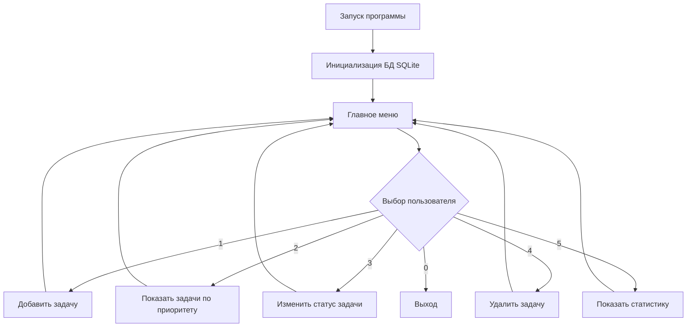

# Менеджер задач (To-Do List) с приоритетами

Консольное приложение на Python для управления личными задачами.
Позволяет создавать задачи, назначать приоритеты, изменять статусы
и просматривать статистику. Данные сохраняются в базе SQLite.

## Возможности

- Создание задач с названием, описанием и приоритетом
- Просмотр задач с сортировкой по приоритету (Высокий, Средний, Низкий)
- Изменение статуса задачи (Новая, В работе, Выполнено)
- Удаление задач по идентификатору
- Просмотр статистики выполненных и невыполненных задач

## Требования

- Python 3.11+
- РЕД ОС 7.3 или другой Linux
- Git
- pytest и flake8 (устанавливаются из requirements.txt)
- Doxygen (для генерации документации)

## Установка и запуск

```bash
# 1. Клонировать репозиторий
git clone https://github.com/a-mozhaev/task_manager.git
cd task_manager

# 2. Создать виртуальное окружение
python3.11 -m venv venv

# 3. Активировать окружение
source venv/bin/activate

# 4. Установить зависимости
python -m pip install -r requirements.txt

# 5. Запустить программу
./run.sh
```

Для автоматической установки зависимостей и инициализации
базы данных можно использовать:

```bash
./install.sh
```

При первом запуске автоматически создаётся база данных
`project.db` с таблицей `tasks`.

## Тестирование

Запуск модульных тестов:

```bash
./test.sh
```

Проверка качества кода и запуск тестов:

```bash
./ci_tasks.sh
```

Полная автоматизированная проверка проекта:

```bash
./build_and_test.sh
```

Последний скрипт последовательно выполняет Flake8,
pytest и генерацию документации Doxygen.

## Структура проекта

```text
task_manager/
├── .vscode/
│   └── tasks.json       # Запуск тестов из VSCodium
├── venv/                # Виртуальное окружение
├── .gitignore           # Исключения Git
├── README.md            # Документация проекта
├── requirements.txt     # Зависимости Python
├── Doxyfile             # Конфигурация Doxygen
├── main.py              # Консольный интерфейс
├── logic.py             # Бизнес-логика
├── db.py                # Работа с базой данных
├── test_logic.py        # Тесты бизнес-логики
├── test_db.py           # Тесты базы данных
├── install.sh           # Установка приложения
├── run.sh               # Запуск приложения
├── test.sh              # Запуск тестов
├── ci_tasks.sh          # Автоматизированная проверка
├── build_and_test.sh    # Полная проверка проекта
└── project.db           # База данных SQLite
```

Каталоги `venv/` и `html/`, а также файл `project.db`
создаются автоматически и не добавляются в Git.

## Блок-схема работы



## Документация Doxygen

Генерация HTML-документации:

```bash
doxygen Doxyfile
```

Открытие документации:

```bash
xdg-open html/index.html
```

Документация содержит описание модулей и функций приложения.

## Автор

Можаев Артём Викторович, группа ПРз-23, 2026

Специальность: 09.02.07 Информационные системы и программирование
